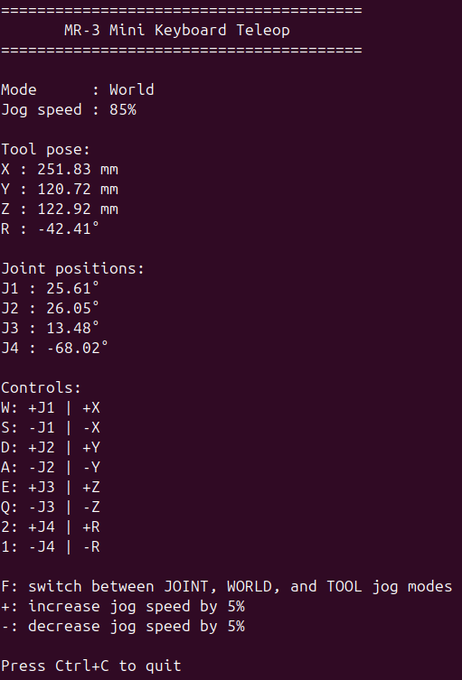

# Modena Teleop
ROS 2 teleoperation tools for Modena robots.

This package provides teleoperation tools for manually controlling Modena robots through ROS 2.

It publishes `JogCmd` messages that can be consumed by compatible robot drivers.



## Features
- Keyboard teleoperation

## Installation
This package assumes an existing ROS 2 workspace.

Clone the repository into your workspace:

```bash
cd ~/ros2_ws/src
git clone https://github.com/modena-robotics/modena_teleop.git
```

Build the package:

```bash
cd ~/ros2_ws
colcon build --packages-select modena_teleop
source install/setup.bash
```

## Usage
After starting the `mr3_mini_driver` node, either directly or through a launch file, and establishing communication with the robot controller, start the keyboard teleoperation node:

```bash
ros2 run modena_teleop keyboard_teleop
```

The node publishes `JogCmd` messages to jog the robot in JOINT, WORLD, or TOOL mode.

The active jog mode determines whether the keys control joint or Cartesian motion.

### Keyboard Controls
| Key | Action |
|------|----------|
| `W` | +J1 / +X |
| `S` | -J1 / -X |
| `D` | +J2 / +Y |
| `A` | -J2 / -Y |
| `E` | +J3 / +Z |
| `Q` | -J3 / -Z |
| `2` | +J4 / +R |
| `1` | -J4 / -R |
| `F` | Switch between jog modes |
| `+` | Increase jog speed by 5% |
| `-` | Decrease jog speed by 5% |
| `Ctrl+C` | Exit |

## Compatibility
Tested with ROS 2 Jazzy.

## License
This project is licensed under the BSD 3-Clause License.